#   
Chat GPT in GPT means Generative Pretrained Transformer.   
Many different transformer such as text to image, text to voice  
Transformer started in 2017 used for translation. The text will be predicted repeatedly. So for example. Let’s suppose 저는 is added to the transformer and transformer predicted next word 학생 so the sentence will look like 저는 학생 Then 저는학생 will be added to the transformer and transformer will predict 입니다. So these ai models do One word at a time.  
  
First input are separated into token. If the input is text, the text will be separated into words.   
Words embedding  
The text input will be multiply by the weight and for example let’s go EOS first let’s will be 1 and go and EOS will be 0. So only let’s 1 will multiply by the weight and the activation function will be f(x) = x. The weights are determined by backpropagation.   
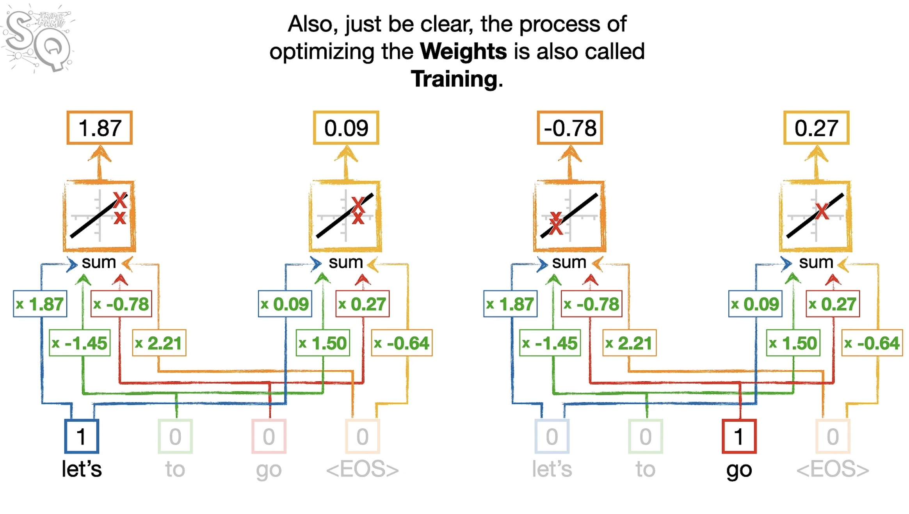  
Backpropagation  
Y = ax + b  
The slope shift until it found the optimal value. Also in neural network the weight stat with random number but when we train the transformer with English and Korean words. Backpropagation optimize one step at a time to get final weights.  
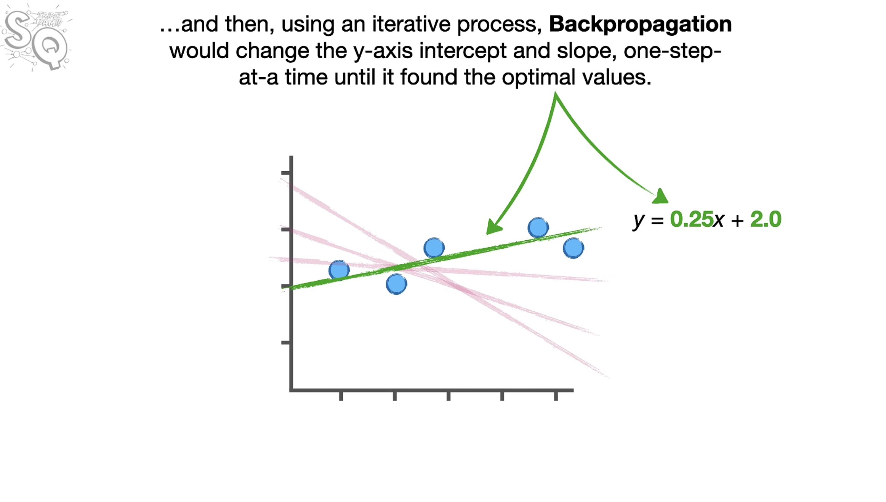  
  
Position encoding  
For example, if we input “professor eat pizza” the model have to keep track of word order. Using sin and cosin squiggle. There are different position encoding.   
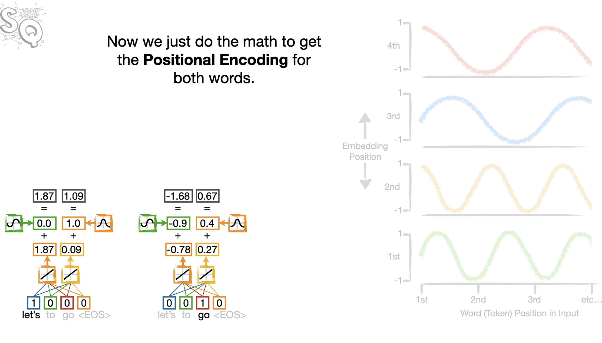  
Self attention is for example “the pizza is out of oven and it is delicious” but the machine does not know it means pizza or oven. So self attention is compare the first word “the” with the rest of the word and itself. And it continues.   
  
For example if we compare the words “let’s” itself and “go”. We multiply position embedding values of “let’s” with weights to get query.  
Then we will create two key of “let’s” by multiplying position embedding values with weight. Then, we will create two keys for “go” with same weight. Then we will multiply “let’s” query and “let’s” key and added. It is the same for “go”. We will use dot product similarity. Compare the two new value and we can see 11.7 is bigger that -2.6 so let’s is more similar itself than “go”. Then use softmax function. Since “let’s” is more similar itself than “go” we will use 100% of “let’s” to encode “let’s” and 0% of “go” to encode “let’s”. So we create two more values of “let’s” and “go” which we will call “values” and multiply softmax value accordingly and added. Then we got two self attention values.  
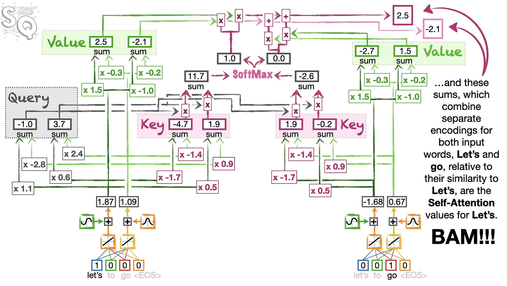  
For “go” we can just create query for “go” and do the same process. Weights are different but same for each type.  
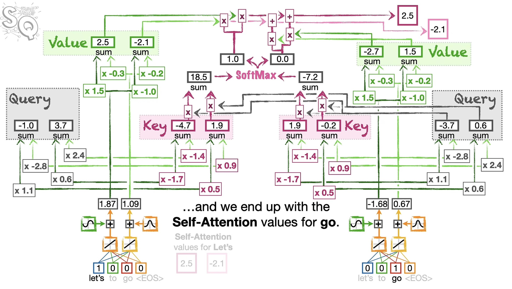  
We can call weight, queries, keys and values as attention cell. 8 self attention cell is called multi head attention.  
  
We add position encoding value to the self attention value. We got residual connection value.  
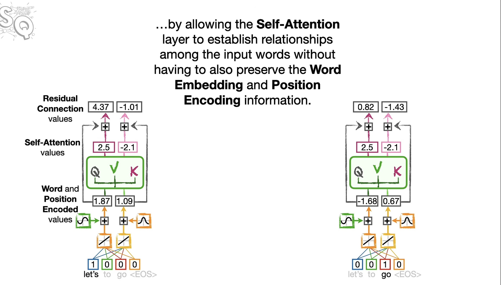  
Second part (Decorder)  
Self attention.  
Start with EOS token. Same process. Then do residual connection value.  
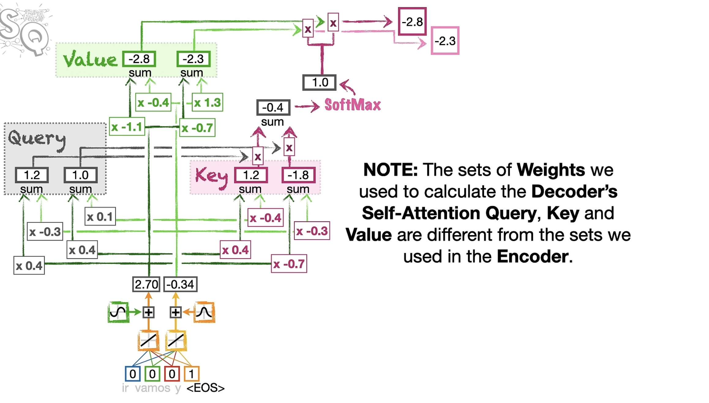  
Encoder-Decoder-Attention  
We got attention value then we multiply attention value of EOS with the weight to get query.  
Multiply attention value of “let’s” and “go” with the same weight to get key. Then we multiply query with keys and run softmax. Then we will know which word to be translated first.  
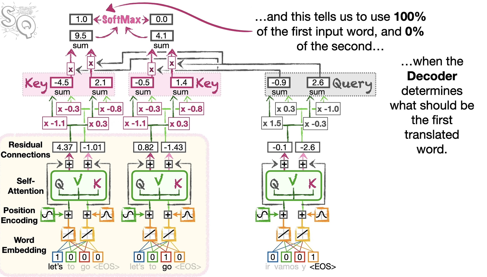  
Then we create two new values and process with softmax value to get encoder-decoder attention value. The sets of weight we use in encoder-decoder-attention is different with self attention.  
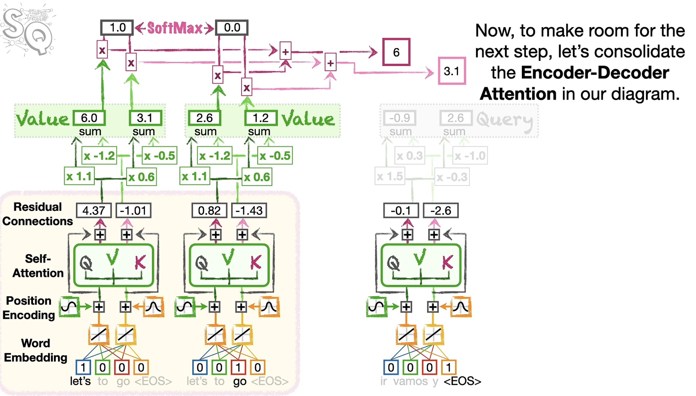  
Then add previous residual connection value and new attention value to get new residual connection values.  
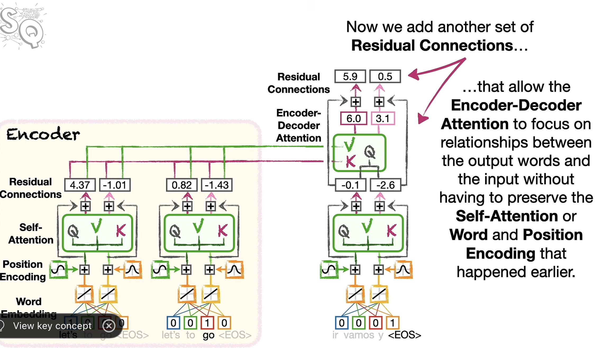  
Then we pass through the final two number to the fully connected layer. Since the total output is 4, the residual connection values will be multiply by weight and added bias. Then we will do softmax function to select the first output word.   
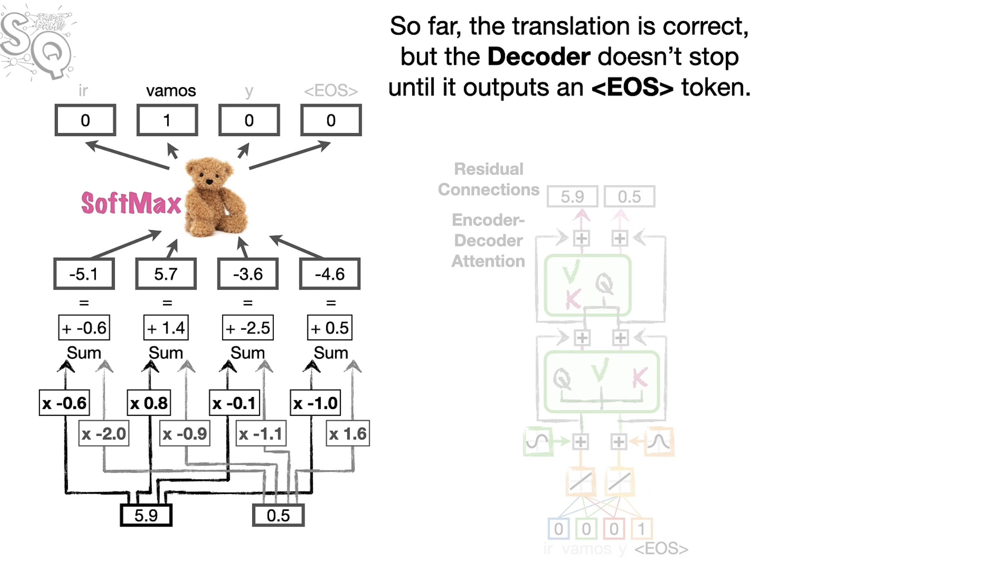  
The decoder won’t stop until it select EOS as output. Then the same process start with vamos.  
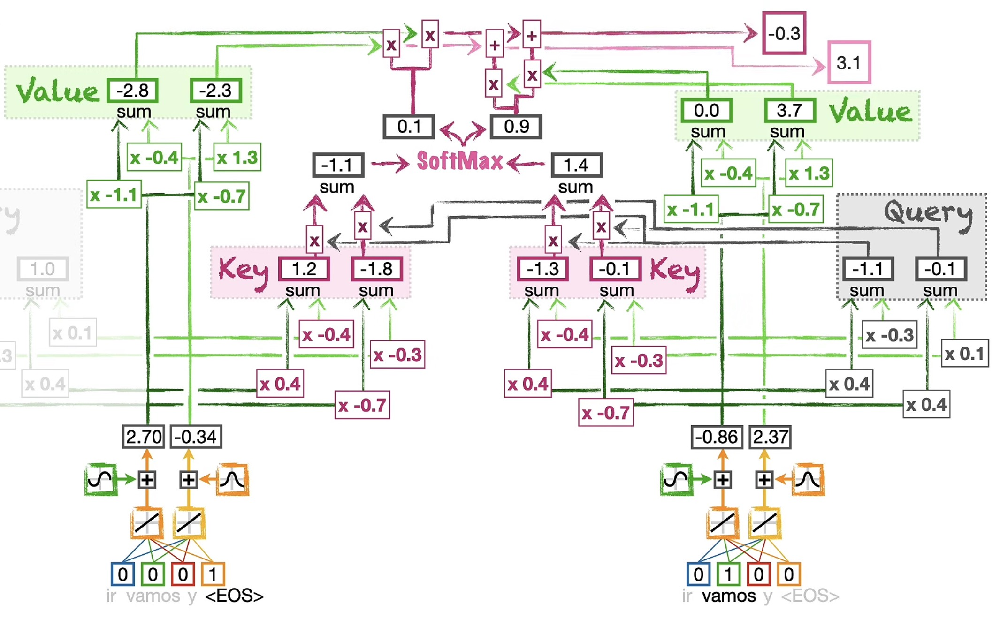  
