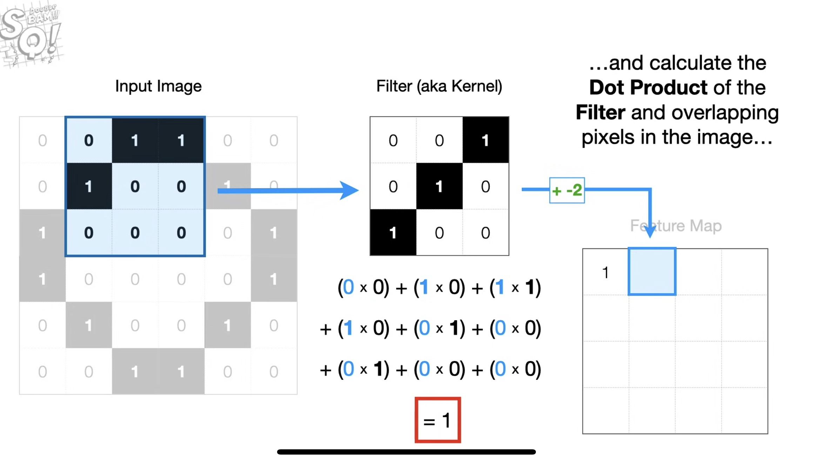

# Convolutional Neural Networks (CNN)

**Convolutional Neural Networks (CNNs)** are a type of neural network built especially for images and grid data. Instead of looking at every single pixel separately, a CNN scans small patches of an image to spot simple patterns first (like lines and edges) and combines them into whole objects (like faces or cars).

---

### The 4 Main Building Blocks of a CNN

1. **Convolutional Layer (The Pattern Scanner):** Slides a small grid (called a filter or kernel, usually $3 \times 3$ pixels) across the image to detect features like edges, corners, or colors.
2. **ReLU Layer (The Clean-Up Step):** Replaces all negative numbers with `0`. This keeps only useful positive pattern matches and helps the network learn complex shapes.
3. **Pooling Layer (The Shrink Step):** Shrinks the image summary (for example, Max Pooling keeps only the strongest number in every $2 \times 2$ box). This makes the model faster and helps it recognize an object even if it shifts slightly left or right.
4. **Fully Connected Layer (The Final Decision):** Flattens all discovered clues into a single list and votes on the final label (for example: 95% Cat, 4% Dog, 1% Fox).

---

### Output Size Formula

Use this formula to calculate the width or height $O$ of the feature map after a convolution or pooling layer:

$$
O = \left\lfloor \frac{W - K + 2P}{S} \right\rfloor + 1
$$

- **$O$:** Output height or width in pixels.
- **$W$:** Input height or width in pixels.
- **$K$:** Filter (kernel) size (for example, $3$ for a $3 \times 3$ filter).
- **$P$:** Number of zero-padding pixels added around the border.
- **$S$:** Stride (how many pixels the filter jumps at each step).

---

### CNN vs. Regular Neural Network

| Feature | CNN | Regular Neural Network (MLP) |
| :--- | :--- | :--- |
| **How it reads an image** | Scans small neighboring patches | Squashes all pixels into one long line |
| **Keeps image layout?** | Yes (knows which pixels are next to each other) | No (loses top, bottom, left, right structure) |
| **Number of settings (Weights)** | Low (reuses the same small filters everywhere) | Very high (every pixel connects to everything) |
| **Best Used For** | Photos, videos, medical scans | Spreadsheets, tables, basic number data |

---

### Good Points & Weak Points

- **Learns patterns automatically:** You do not have to manually teach it what an edge or wheel looks like—it figures that out from examples.
- **Efficient with weights:** Reusing the same small filter across the whole photo saves huge amounts of memory.
- **Needs lots of training data:** Usually requires thousands of labeled images to become accurate.
- **Focuses mostly on nearby pixels:** Because filters are small, a CNN needs many stacked layers to understand how far-apart parts of a big image relate to each other.

  
Max pooling maximum number.  
Average pooling mean.  
  

Link to study: https://www.youtube.com/watch?v=HGwBXDKFk9I&t=2s
