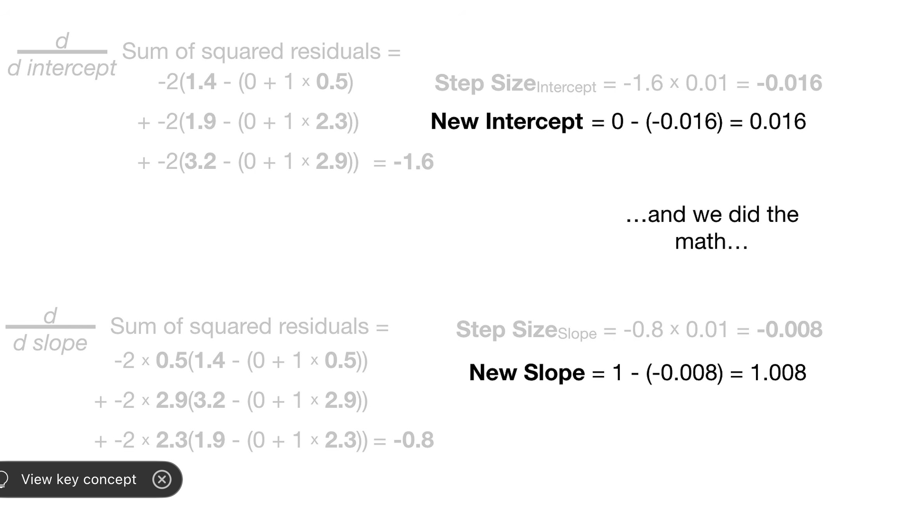
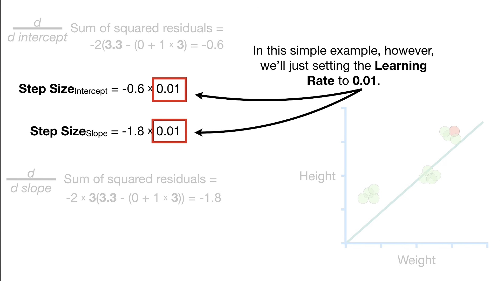

# SGD
Stochastic Gradient Descent (SGD) is an iterative optimization algorithm used in machine learning to minimize a loss function by updating model parameters using one randomly selected training sample at each step, rather than computing gradients across the entire dataset.
How SGD Works
In standard (Batch) Gradient Descent, the model evaluates all training examples before making a single parameter update. On large datasets, this is slow and memory-intensive.
SGD solves this by shuffling the dataset each epoch and updating the parameters immediately after evaluating the loss gradient on a single sample

Instead of linear and logistic regression  
  
  
  
  
And repeat the derivative until the steps become small  
Let’s suppose we have to calculate 1,000,000 terms for 23,000 derivatives we have to calculate 23,000,000,000 terms. And we need at least 1,000 steps. We need many steps.  
So SGD reduce the computing terms by factor of 3.  
Good to use where there are redundancy (စုဖွဲ့မှု) in dataset. Choose one data and do the math same as Gradient Descent.   
Changing learning rate is called sechdule.   
  
Do the math and we got new intercept and new slope then we pick another data from different redundancy and do the math again. Repeat again and again with new data.  
We can also use 3 data per step which is called mini-batch. Much faster.  
The advantage of SGD is if there is new data, we don’t have to start from the scratch, we can simply calculate the new slope and intercept.

| Variant | Samples per Update | Convergence Behavior | Primary Trade-off |
| :--- | :--- | :--- | :--- |
| **Batch GD** | All $N$ samples | Smooth, direct path to minimum | Too slow and memory-heavy for large datasets |
| **Stochastic GD (SGD)** | $1$ random sample | Noisy, zig-zag path toward minimum | Very fast updates, but high variance near the minimum |
| **Mini-Batch SGD** | $32$–$512$ samples | Stable path with mild noise | Best balance of GPU efficiency and convergence speed |

### Advantages and Limitations

- **Fast initial progress:** Because updates happen after every sample, the model starts improving immediately instead of waiting for a full pass over the data.
- **Escapes shallow local minima:** The randomness ("noise") in single-sample gradients can bounce parameters out of saddle points or poor local minima in non-convex loss surfaces.
- **Noisy oscillations:** Near the global minimum, the parameters continue oscillating rather than settling cleanly unless the learning rate $\eta$ is gradually decayed.
- **Sensitive to feature scaling:** Input features with different scales cause elongated loss contours, making SGD oscillate heavily unless features are normalized first.
