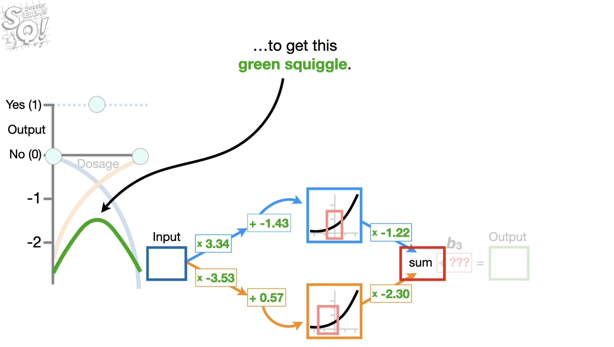
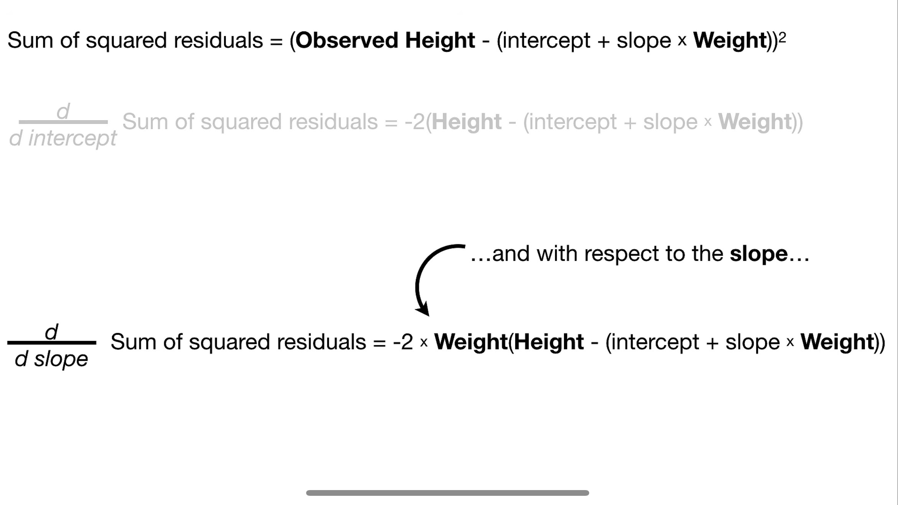

# SGD  
Instead of linear and logistic regression  
  
  
  
  
And repeat the derivative until the steps become small  
Let’s suppose we have to calculate 1,000,000 terms for 23,000 derivatives we have to calculate 23,000,000,000 terms. And we need at least 1,000 steps. We need many steps.  
So SGD reduce the computing terms by factor of 3.  
Good to use where there are redundancy (စုဖွဲ့မှု) in dataset. Choose one data and do the math same as Gradient Descent.   
Changing learning rate is called sechdule.   
  
Do the math and we got new intercept and new slope then we pick another data from different redundancy and do the math again. Repeat again and again with new data.  
We can also use 3 data per step which is called mini-batch. Much faster.  
The advantage of SGD is if there is new data, we don’t have to start from the scratch, we can simply calculate the new slope and intercept.  
