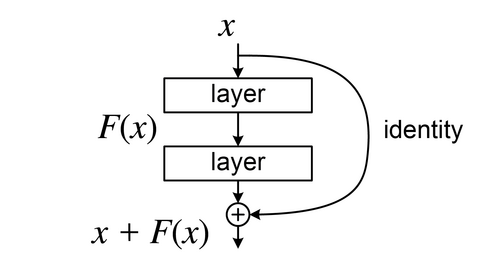

# ResNet / Skip Connection

**A Skip Connection (Residual Block)** is a plug-in shortcut path that carries the original input directly around one or more layers and adds it to the output. It lets deep networks grow dozens or hundreds of layers deep without losing the training signal.

---

### Everyday Analogy

Imagine passing a message down a long line of people who each whisper it to the next person. By the end, the message fades away. If you also hand an exact photocopy straight ahead every few people, the original message arrives intact even if middle steps make small errors.

---

### How It Works

1. **Main Path:** Input $x$ goes through stacked layers (such as convolutions) to learn a small adjustment $F(x)$.
2. **Skip Connection:** At the same time, an unchanged copy of $x$ skips directly over those layers.
3. **Addition:** The network adds the adjustment $F(x)$ and the original input $x$ together before moving forward.

---

### Formula

$$
y = F(x, \{W_i\}) + x
$$

If $x$ and $F(x)$ have different shapes or channel counts, multiply $x$ by a $1 \times 1$ projection matrix $W_s$ first so both tensors match in size:

$$
y = F(x, \{W_i\}) + W_s x
$$

- **$y$:** Final output leaving the residual block.
- **$x$:** Original input entering the block.
- **$F(x, \{W_i\})$:** The residual change learned by the stacked layers with weights $W_i$.
- **$W_s$:** Optional $1 \times 1$ layer used only when input and output dimensions do not match.
- 

---

### Standard Layer Stack vs. Skip Connection

| Feature | Standard Layer Stack | With Skip Connection |
| :--- | :--- | :--- |
| **What Layers Learn** | Full output mapping from scratch | Only the small difference from input $x$ |
| **Gradient Flow** | Shrinks in deep networks (vanishing gradient) | Flows straight backward through the shortcut |
| **Extra Weights** | Standard layer weights | Zero extra weights when shapes match |

---

### Good Points & Weak Points

- **Prevents vanishing gradients:** Gives error signals a direct path back to early layers during backpropagation.
- **Easy to plug in:** Can be wrapped around almost any convolutional or linear block with minimal cost.
- **Still uses compute:** Adding skip connections solves training depth issues, but very deep stacks still need significant memory and time.

- ## 1. FAQ

### 1. What motivated the development of ResNet?

   In neural network deep learning, as the layers are increasing in order to improve performance, there can be the drawback. As layers are increasing, the input data passing layers by layers can cause training and testing error. Since the error is not overfitting, it is very difficult to optimize. That's why ResNet was created to solve these problem.
   
### 2. Why can simply stacking more layers in a neural network lead to worse performance?

   As the data pass through layer by layer, the activation functions can distort the original data signal. Overtime, the data might be twisted and when reaching the last layer, the final output might not be related to the original input.
   
### 3. What is a skip connection?

   A skip connection is a parallel procedure. In the main path, the input just pass like normal, adding weight and activation function where in the branch path, the original input was carried and added at the end of the layer.
   
### 4. How does a skip connection pass the input \(x\) to the next block?

   There are two scenarios. In identity shortcut, the output size and type is same with input. So, the input data is simply added to the output. In projection shortcut, if the layer shrink or expand the data (using stride = 2), the output data shape and size might not be related to the input data. In this scenario, the input data that will be added to the output data must be aligned with the shape or resize its dimension according to the output.
   
### 5. What is the difference between a standard CNN block directly learning \(H(x)\) and a ResNet block learning the residual function \(F(x) = H(x) - x\)?

   In a standard CNN block, the layers try to learn $H(x)$ directly from scratch. Take the input, apply new transformations, and output the complete result on their own.
In a ResNet block, the network produce that exact same target output $H(x)$, but it splits the work in two. The convolutional layers only learn the difference (residual) between the desired output and the original input, and the skip connection adds the original input back at the end of $H(x)$.
Think of $x$ as a rough pencil sketch and $H(x)$ as the finished, shaded drawing. A standard block tries to redraw the entire picture from a blank page, whereas a ResNet block keeps your original sketch and only learns to draw the shading on top of it.

### 6. Why does residual learning make a network easier to train?
  
  Because a ResNet block already receives the original input for free through the skip connection, layers only have to learn small adjustments rather than rebuilding the entire output from scratch. That makes training much easier. For example, if a layer does not need to change anything, it just shrinks its weights toward zero. When the layers output zero, adding the skip connection leaves the original input completely intact. Even when a layer does need to transform the features, the output in deeper layers is usually just a small adjustment. For example, adding shading to an existing pencil sketch rather than redrawing the whole picture. Optimizing small differences on top of an intact starting point gives the training process a much smoother, more reliable path than every layer to reconstruct everything from scratch.
  
### 7. How do skip connections improve gradient flow?

In a standard deep network, the gradient must pass sequentially through every single layer and activation function on its way to the front. At each step, the gradient gets multiplied by small weights and activation functions. After passing through 50 or 100 layers, the gradient shrinks so much that it fades to almost nothing before reaching the earliest layers. Because a skip connection creates a direct shortcut around the layers, the backward error signal splits into two paths every time it reaches a residual block. In the main path, one copy of the error signal passes through the layers inside the block so they can update their weights and improve. In the shortcut, a second, untouched copy travels straight down the skip connection, completely bypassing layers and their activation functions. Then second copy added to the first copy and do the same process again and again until reach the front.

Link to study: https://www.youtube.com/watch?v=Q1JCrG1bJ-A&t=850s
